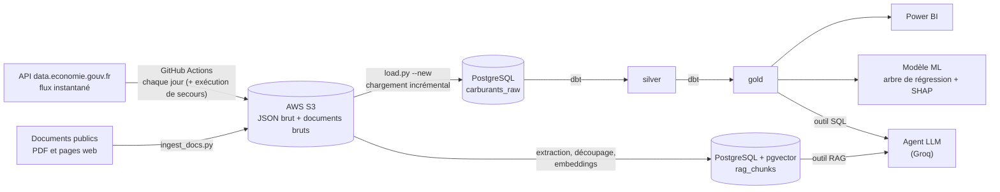
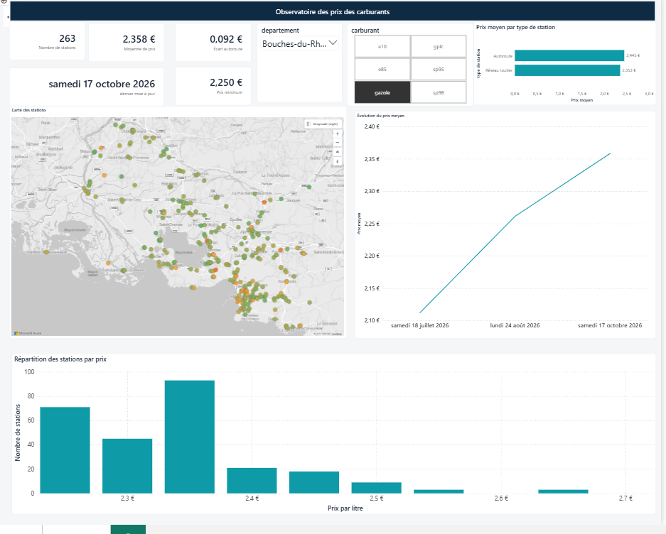

# Observatoire des prix des carburants en France

Projet de données de bout en bout autour des prix des carburants (données ouvertes) :

- **Data engineering** : ingestion quotidienne automatisée, stockage brut sur S3, entrepôt PostgreSQL, transformations et tests de qualité avec dbt.
- **BI** : rapport Power BI sur le dernier relevé et l'historique.
- **Machine learning** : modèle explicable du prix d'une station à partir de ses caractéristiques (arbre de régression, SHAP).
- **LLM / RAG / agent** : un assistant qui répond en français en interrogeant la base de prix (SQL) ou un corpus de documents explicatifs (RAG), avec ses sources.

## Objectif

Suivre l'évolution des prix des carburants (gazole, SP95, SP98, E10, E85, GPLc) par département et par type de station, construire un historique exploitable, et rendre ces données accessibles en langage naturel.

Questions auxquelles le projet répond :
- Comment évolue le prix moyen de chaque carburant, par département ?
- Où le carburant est-il le moins cher (par exemple autour de Marseille, ou en PACA) ?
- Quel est l'écart de prix entre autoroute et hors autoroute, et **pourquoi** existe-t-il ?
- Quelles caractéristiques d'une station expliquent son prix ?

## Architecture



| Couche | Contenu |
|---|---|
| Bronze (brut) | JSON tel que reçu de l'API sur S3 (`<date>_<heure>/prix_bruts.json`), documents bruts sur S3 (`docs/raw/`), puis table `carburants_raw` (une ligne par station et par jour de snapshot) |
| Silver | Données nettoyées : `silver_stations` (une ligne par station, informations les plus récentes) et `silver_prices` (un prix par station, carburant et jour) |
| Gold | Tables prêtes pour l'analyse : `gold_stations_prices` (stations avec prix), `gold_prix_quotidien_dept` (série quotidienne par département et carburant), `gold_stats_region` |
| RAG | `rag_chunks` : passages des documents avec leurs métadonnées (source, titre, date, page) et leur vecteur (`vector(768)`) |

## Rapport Power BI



Une page unique : indicateurs clés (stations, prix moyen, prix minimum, écart entre autoroute et réseau routier), carte des stations colorée selon le prix, évolution du prix moyen dans le temps et répartition des stations par prix. Les filtres de département et de carburant s'appliquent à toute la page. Les indicateurs, la carte et les graphiques portent sur le dernier relevé, la courbe montre l'historique.

## Modèle de machine learning

**Question** : quel prix attendre pour une station, à partir de ses caractéristiques (position, services, type de station…) ?

- **Modèle retenu** : arbre de régression (profondeur 10, au moins 50 stations par feuille).
- **Validation croisée par département** : les stations d'un même département ne sont jamais à la fois en entraînement et en validation, pour éviter une fuite d'information géographique. Erreur absolue moyenne : 5,24 centimes, contre 5,83 pour la baseline.
- **Arbre plutôt que forêt aléatoire** : la forêt fait à peine mieux (5,06 centimes), pour un modèle beaucoup moins lisible et plus lent. L'écart ne justifie pas la perte de lisibilité.
- **Test final sur 20 départements jamais vus** : MAE 5,41 centimes (baseline 5,94), RMSE 7,52, R² 0,19. L'erreur varie de 3,8 à 10,3 centimes selon le département. Les stations affichant 2,25 € (18,6 % du test) sont nettement moins bien prédites (9,0 centimes d'erreur, contre 4,6 pour les autres).
- **Explicabilité avec SHAP** : la position, les services et la présence sur autoroute pèsent le plus, jusqu'à +16 centimes sur le prix.

Le R² modeste est cohérent avec le sujet : une grande partie du prix dépend de facteurs absents des données (enseigne, stratégie commerciale, concurrence locale).

## Assistant LLM (RAG et agent)

L'assistant répond à deux types de questions :
- **sur les données** : « Quel est le prix du gazole à Marseille ? », « Le SP98 est-il plus cher à Marseille qu'à Lyon ? » → requête SQL sur la couche gold ;
- **sur le contexte** : « Pourquoi le carburant est-il plus cher sur l'autoroute ? » → recherche dans un corpus de 9 documents publics (Assemblée nationale, Autorité de régulation des transports, CLCV, IÉSEG, Connaissance des Énergies, TotalEnergies, data.gouv.fr).

### Pipeline RAG

1. **Ingestion** (`ingestion/ingest_docs.py`) : téléchargement des documents vers S3 (`docs/raw/`), avec un catalogue `sources.csv` (titre, source, date, URL).
2. **Extraction et nettoyage** (`rag/extraire.py`) : texte page par page pour les PDF (pypdf), zone principale de l'article pour les pages web (BeautifulSoup), normalisation des espaces.
3. **Découpage** (`rag/decouper.py`) : chunks de 350 caractères avec 70 caractères de chevauchement, chacun avec ses métadonnées.
4. **Indexation** (`rag/indexer.py`) : embeddings `paraphrase-multilingual-mpnet-base-v2` (sentence-transformers, en local), stockés dans PostgreSQL avec pgvector. Script relançable (vidage puis remplissage dans une seule transaction).
5. **Recherche** (`rag/rechercher.py`) : distance cosinus (`<=>`), puis **fenêtre de contexte** : chaque chunk retrouvé est envoyé au LLM avec ses voisins dans le document.
6. **Génération** (`rag/repondre.py`) : réponse en français, uniquement à partir des extraits, avec citations `[n]` et dates.

### Agent

`rag/agent.py` : un LLM (Groq, `openai/gpt-oss-120b`) choisit lui-même ses outils par *tool calling* :
- `prix_carburant(ville, carburant)` (`rag/outils.py`) : prix moyen, minimum et maximum au dernier relevé ;
- `rechercher_documents(question)` : le pipeline RAG ci-dessus.

Sécurités : requêtes SQL paramétrées (pas d'injection), liste fermée de carburants, erreurs renvoyées au LLM sous forme lisible au lieu de faire planter le programme, limite de 5 tours pour éviter les boucles, trace de chaque outil appelé.

### Choix techniques et mesures

- **Fournisseur de LLM découplé** : tout le code passe par une seule fonction, et le fournisseur se choisit dans `.env` (URL, modèle, clé). Passer de Groq à Mistral ou à un modèle local (Ollama) ne demande aucune modification du code.
- **Modèle d'embedding choisi sur mesure** : sur des phrases de test, MiniLM ne rapprochait pas « gazole » et « diesel » (similarité de 0,08). mpnet les rapproche nettement dès qu'il y a du contexte (0,66 entre « Le prix du gazole augmente » et « Le prix du diesel augmente »).
- **Taille des chunks fixée par la mesure** : le modèle ne lit que 128 tokens. Avec des chunks de 500 caractères, 37 % étaient tronqués sans avertissement. À 350 caractères, 3 sur 339 seulement, et leur fin est couverte par le chevauchement.
- **pgvector plutôt qu'une base vectorielle séparée** : les vecteurs vivent dans le même PostgreSQL que les prix. Pas d'index vectoriel : avec quelques centaines de chunks, la recherche exacte prend quelques millisecondes.

### Amélioration itérative (question « Pourquoi le carburant est-il plus cher sur l'autoroute ? »)

| Version | Réponse obtenue | Diagnostic |
|---|---|---|
| LLM seul | « taxes spécifiques aux autoroutes » | Hallucination : ces taxes n'existent pas |
| RAG v1 | personnel 24 h/24 + « stations isolées, logistique » | Le corpus n'expliquait pas la question (vérifié en SQL) ; ajout de deux documents ciblés. Explication inventée et attribuée à une vraie source |
| Consignes strictes | personnel 24 h/24 seulement | Exact mais incomplet : la liste des raisons était coupée entre deux chunks |
| Consignes + fenêtre de contexte | personnel 24 h/24, redevances aux sociétés d'autoroute, services gratuits, écart d'environ 10 % | Complet, sourcé et daté |

Les autres questions de test ont été relancées à chaque étape pour vérifier l'absence de régression.

## Stack technique

Python (requests, boto3, pandas, SQLAlchemy, scikit-learn, SHAP, sentence-transformers, pypdf, BeautifulSoup), AWS S3, PostgreSQL, pgvector, dbt, GitHub Actions, Power BI, API Groq (format OpenAI).

## Structure du dépôt

```
.
├── .github/workflows/ingest.yml   # ingestion quotidienne (cron) vers S3
├── ingestion/
│   ├── ingest.py                  # API -> S3 (retries, erreurs explicites, horodatage UTC)
│   ├── load.py                    # S3 -> PostgreSQL (incrémental, idempotent par jour)
│   └── ingest_docs.py             # documents du corpus RAG -> S3
├── dbt_carburants/                # modèles silver et gold, tests de qualité
├── ml/                            # modèle explicable (arbre de régression, SHAP)
├── rag/
│   ├── llm.py                     # appel au LLM (fournisseur défini dans .env)
│   ├── extraire.py                # S3 -> texte (PDF et HTML), nettoyage
│   ├── decouper.py                # texte -> chunks avec métadonnées
│   ├── indexer.py                 # chunks -> embeddings -> pgvector
│   ├── rechercher.py              # recherche vectorielle + fenêtre de contexte
│   ├── repondre.py                # RAG complet : recherche + génération sourcée
│   ├── outils.py                  # outils de l'agent (requêtes SQL)
│   └── agent.py                   # agent : choix des outils par tool calling
└── README.md
```

## Choix de conception (pipeline de données)

- **Un snapshot par jour** : le flux instantané ne contient que le dernier prix connu de chaque station, qui change quelques fois par semaine. Un snapshot quotidien suffit à reconstituer l'historique sans stocker de doublons.
- **Stockage brut conservé** : les octets reçus de l'API, comme les documents, sont déposés tels quels sur S3, ce qui permet de rejouer toutes les transformations.
- **Chargement incrémental et idempotent** : `load.py --new` ne charge que les jours absents de la base. Chaque jour est supprimé puis réinséré dans une seule transaction : relancer le script ne crée aucun doublon, et une erreur n'efface jamais un jour déjà chargé. `--all` reconstruit tout l'historique.
- **Planification robuste** : les horaires du workflow évitent les heures pile (créneaux où GitHub retarde le plus les tâches planifiées), et une exécution de secours en milieu de journée couvre les jours manqués. Le chargement raisonnant par date, un second snapshot le même jour est sans effet.
- **Une ligne par station dans `silver_stations`** : évite de multiplier les lignes lors de la jointure avec les prix quand l'historique grandit.
- **Format long pour les prix** : la table brute a une colonne par carburant, `silver_prices` la transforme en une ligne par carburant (boucle Jinja dbt), plus simple à agréger.
- **Droits minimaux** : le workflow utilise un utilisateur AWS dédié qui peut seulement écrire dans le bucket, avec des secrets GitHub.

## Qualité des données

Les tests dbt (`dbt test`) vérifient :
- l'unicité et la présence des identifiants de station et des coordonnées GPS ;
- l'unicité d'un prix par station, carburant et jour ;
- les valeurs possibles du type de carburant ;
- l'unicité d'une ligne par jour, département et carburant dans la table gold quotidienne ;
- la plausibilité des prix (alerte hors de 0,5 à 4 € par litre).

## Lancer le projet

Prérequis : Python 3.12 ou plus, PostgreSQL avec l'extension pgvector, un bucket S3, un profil dbt configuré (`profiles.yml`), une clé API Groq (gratuite).

1. Installer les dépendances : `pip install -r requirements.txt`
2. Créer un fichier `.env` à la racine (il est exclu du dépôt par `.gitignore`) :
   ```
   BUCKET_NAME=nom-du-bucket
   DB_USER=...
   DB_PASSWORD=...
   DB_NAME=carburants
   DB_HOST=localhost
   DB_PORT=5432
   LLM_BASE_URL=https://api.groq.com/openai/v1
   LLM_MODEL=openai/gpt-oss-120b
   LLM_API_KEY=...
   ```

**Données de prix**

3. Récupérer un snapshot et le déposer sur S3 : `python ingestion/ingest.py`
4. Charger les nouveaux snapshots dans PostgreSQL : `python ingestion/load.py --new` (ou `--all` pour tout reconstruire)
5. Construire et tester les modèles : `dbt run` puis `dbt test`

En production, l'étape 3 est exécutée chaque jour par GitHub Actions (secrets requis : `AWS_ACCESS_KEY_ID`, `AWS_SECRET_ACCESS_KEY`, `AWS_DEFAULT_REGION`, `BUCKET_NAME`).

**Assistant LLM**

6. Activer pgvector et créer la table des chunks :
   ```sql
   CREATE EXTENSION IF NOT EXISTS vector;
   CREATE TABLE rag_chunks (
       id SERIAL PRIMARY KEY, fichier TEXT NOT NULL, titre TEXT, source TEXT,
       date_doc DATE, url TEXT, page INT, contenu TEXT NOT NULL, embedding vector(768) NOT NULL
   );
   ```
7. Déposer les documents sur S3 : `python ingestion/ingest_docs.py`
8. Indexer les documents : `cd rag` puis `python indexer.py`
9. Interroger l'assistant : `python agent.py` (ou `python repondre.py` pour le RAG seul)

## Limites et prochaines étapes

- **Historique en construction** : l'ingestion quotidienne a démarré en octobre 2026, complétée par deux snapshots antérieurs (juillet et août 2026). La série temporelle gagne en profondeur chaque jour.
- **Chargement PostgreSQL local** : seule l'ingestion vers S3 est automatisée. Héberger la base permettrait d'automatiser aussi le chargement, dbt et la réindexation.
- **Fraîcheur des documents** : certains documents datent de 2012 à 2014. Leurs mécanismes restent valables, mais leurs chiffres sont anciens ; l'assistant précise les dates. Un même document peut aussi contenir des chiffres d'âges différents (part des taxes au 6 mars et au 24 août 2026) : la recherche ne remonte pas toujours le plus récent.
- **Respect des consignes** : le LLM peut encore ajouter des exemples ou des déductions absents des sources. Prochaine étape : un jeu d'évaluation (questions, réponses attendues, passages à retrouver) relancé après chaque modification, pour mesurer la qualité de la recherche et la fidélité des réponses.
- **Pistes d'amélioration du RAG** : recherche hybride (mots-clés + vecteurs), comparaison avec des modèles d'embedding plus récents, interface Streamlit.
- **Modèle de prévision** : régression sur la série quotidienne par département, avec baseline naïve et validation temporelle, une fois l'historique suffisant.
- **Backfill possible** : l'historique annuel publié par le service public des prix des carburants pourrait être chargé pour allonger la série.

## Sources des données

- Prix des carburants en France, flux instantané, données ouvertes du gouvernement français (data.economie.gouv.fr).
- Documents du corpus RAG : listés avec leur URL et leur date dans `sources.csv` (S3, `docs/raw/`).

## Auteure

Elodie Ishimwe, étudiante en Master Science et Ingénierie des Données, Aix-Marseille Université.
