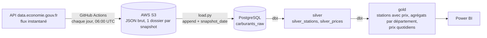
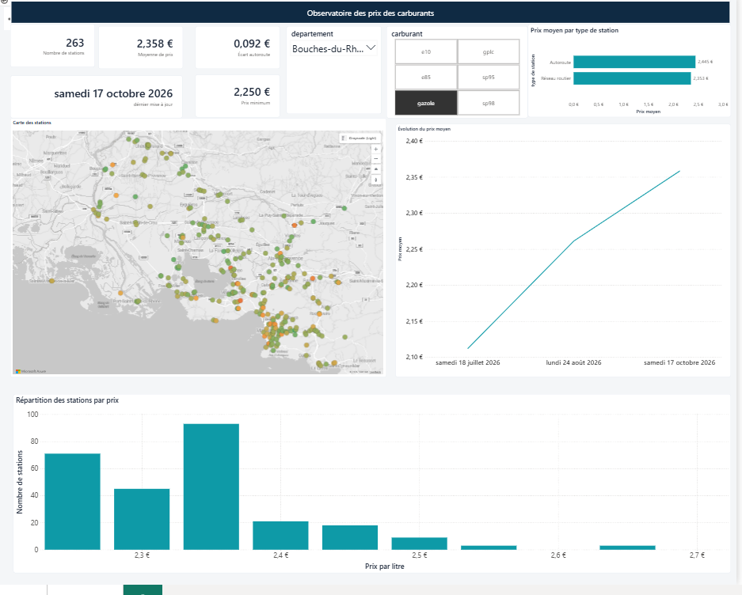

# Observatoire des prix des carburants en France

Pipeline de données de bout en bout : ingestion quotidienne automatisée des prix des carburants (données ouvertes), stockage brut sur S3, entrepôt PostgreSQL, transformations et tests de qualité avec dbt, restitution dans Power BI.

## Objectif

Suivre l'évolution des prix des carburants (gazole, SP95, SP98, E10, E85, GPLc) par département et par type de station, et construire un historique exploitable pour l'analyse et la prévision.

Questions auxquelles le projet répond :
- Comment évolue le prix moyen de chaque carburant, par département ?
- Où le carburant est-il le moins cher (par exemple autour de Marseille, ou en PACA) ?
- Quel est l'écart de prix entre autoroute et hors autoroute ?
- Quelles stations ont des prix aberrants ou très volatils ?

## Architecture



<!-- Ajouter ici une capture du graphe de lignage dbt :

-->

| Couche | Contenu |
|---|---|
| Bronze (brut) | JSON tel que reçu de l'API sur S3, puis table `carburants_raw` (une ligne par station et par jour de snapshot) |
| Silver | Données nettoyées : `silver_stations` (une ligne par station, informations les plus récentes) et `silver_prices` (un prix par station, carburant et jour) |
| Gold | Tables prêtes pour l'analyse : stations avec prix, agrégats par département et type de station, série quotidienne par département et carburant |

## Rapport Power BI



Une page unique : indicateurs clés (stations, prix moyen, prix minimum, écart entre autoroute et réseau routier), carte des stations colorée selon le prix, évolution du prix moyen dans le temps et répartition des stations par prix. Les filtres de département et de carburant s'appliquent à toute la page. Les indicateurs, la carte et les graphiques portent sur le dernier relevé, la courbe montre l'historique.

## Stack technique

Python (requests, boto3, pandas, SQLAlchemy), AWS S3, PostgreSQL, dbt, GitHub Actions, Power BI.

## Structure du dépôt

```
.
├── .github/workflows/ingest.yml   # ingestion quotidienne (cron) vers S3
├── ingestion/
│   ├── ingest.py                  # API -> S3 (retries, erreurs explicites, horodatage UTC)
│   └── load.py                    # S3 -> PostgreSQL (append, idempotent par jour)
├── dbt/                           # modèles silver et gold, tests de qualité
└── README.md
```

## Choix de conception

- **Un snapshot par jour** : le flux instantané ne contient que le dernier prix connu de chaque station, qui change quelques fois par semaine. Un snapshot quotidien suffit à reconstituer l'historique sans stocker de doublons.
- **Stockage brut conservé** : les octets reçus de l'API sont déposés tels quels sur S3, ce qui permet de rejouer toutes les transformations.
- **Chargement idempotent** : `load.py` supprime puis réinsère le jour concerné dans une seule transaction. Relancer le script ne crée aucun doublon, et une erreur n'efface jamais un jour déjà chargé.
- **Une ligne par station dans `silver_stations`** : évite de multiplier les lignes lors de la jointure avec les prix quand l'historique grandit.
- **Format long pour les prix** : la table brute a une colonne par carburant, `silver_prices` la transforme en une ligne par carburant (boucle Jinja dbt), plus simple à agréger.
- **Droits minimaux** : le workflow utilise un utilisateur AWS dédié qui peut seulement écrire dans le bucket, avec des secrets GitHub.

## Qualité des données

Les tests dbt (`dbt test`) vérifient :
- l'unicité et la présence des identifiants de station et des coordonnées GPS ;
- l'unicité d'un prix par station, carburant et jour ;
- les valeurs possibles du type de carburant ;
- l'unicité d'une ligne par jour, département et carburant dans la table gold quotidienne ;
- la plausibilité des prix (alerte hors de 0,5 à 4 € par litre).

## Lancer le projet

Prérequis : Python 3.12 ou plus, PostgreSQL, un bucket S3, un profil dbt configuré (`profiles.yml`).

1. Installer les dépendances : `pip install -r requirements.txt`
2. Créer un fichier `.env` à la racine :
   ```
   BUCKET_NAME=nom-du-bucket
   DB_USER=...
   DB_PASSWORD=...
   DB_NAME=carburants
   DB_HOST=localhost
   DB_PORT=5432
   ```
3. Récupérer un snapshot et le déposer sur S3 : `python ingestion/ingest.py`
4. Charger tous les snapshots dans PostgreSQL : `python ingestion/load.py --all`
5. Construire et tester les modèles : `dbt run` puis `dbt test`

En production, l'étape 3 est exécutée chaque jour par GitHub Actions (secrets requis : `AWS_ACCESS_KEY_ID`, `AWS_SECRET_ACCESS_KEY`, `AWS_DEFAULT_REGION`, `BUCKET_NAME`).

## Limites et prochaines étapes

- **Historique en construction** : l'ingestion quotidienne a démarré en octobre 2026, complétée par deux snapshots antérieurs (juillet et août 2026). La série temporelle gagne en profondeur chaque jour.
- **Chargement PostgreSQL local** : seule l'ingestion vers S3 est automatisée. Héberger la base permettrait d'automatiser aussi le chargement et dbt.
- **Modèle de prévision à venir** : régression sur la série quotidienne par département, avec baseline naïve, validation temporelle et explicabilité (SHAP), une fois l'historique suffisant.
- **Backfill possible** : l'historique annuel publié par le service public des prix des carburants pourrait être chargé pour allonger la série.

## Source des données

Prix des carburants en France, flux instantané, données ouvertes du gouvernement français (data.economie.gouv.fr).

## Auteure

Elodie Ishimwe, étudiante en Master Science et Ingénierie des Données, Aix-Marseille Université.
